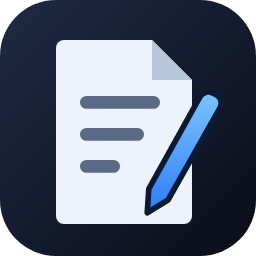
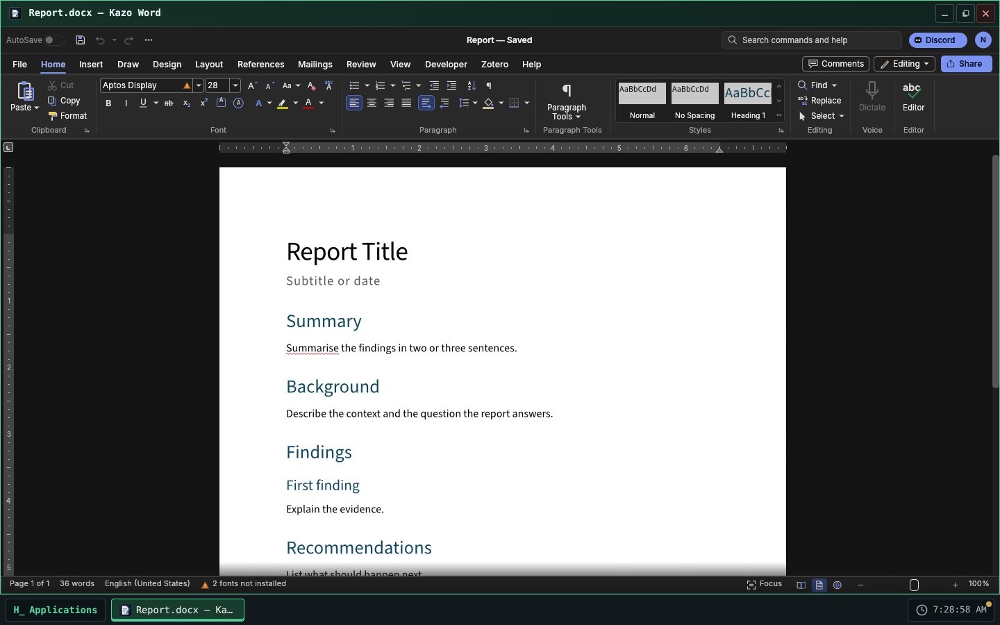
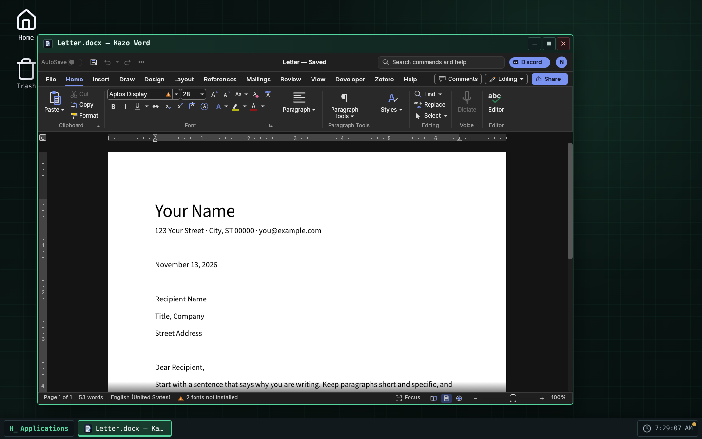
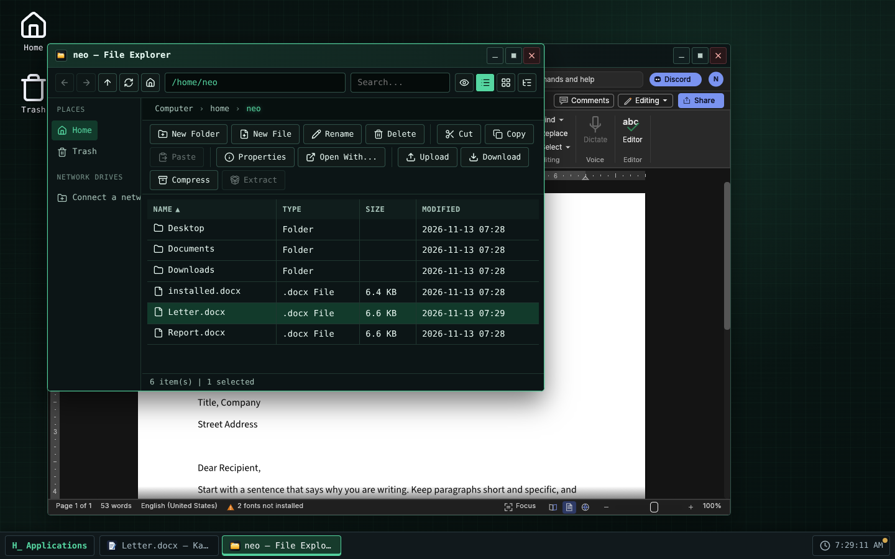

> [Version française](readme-fr.md)

<!-- Store listing: generated from store/ by .github/scripts/store-readme.mjs. Edit store/, then run it. -->



# Kazo Word

A word processor for Kazo OS, for `.docx` and `.odt` documents. Kazo Word is based on
[WordCraft](https://github.com/storytold/wordcraft) by the ArtCraft team, an open-source word
processor written in Rust, which runs here in a Kazo OS window.

## Write

- Pages laid out as they print: styles, fonts, paragraphs, lists, tables, pictures, headers and
  footers, page numbers, footnotes, a table of contents.
- WordCraft's ribbon, its command search and its shortcuts; English spelling checked as you type.
- Several windows at once, one document per window.

## Your Kazo OS files

- Double-click a `.docx`, `.odt`, `.rtf`, `.doc`, `.md`, `.html` or `.txt` file in the File
  Explorer, or use "Open with": the document opens in Kazo Word.
- Save rewrites the file you opened; Save As and the first save of a new document use the Kazo OS
  save dialog. Exports to PDF, PNG, text and Markdown are copies: the document stays bound to its
  file.
- The title bar shows `*` while the document has unsaved changes, and closing the window asks
  before losing them.
- File › Open and the pictures, fonts and mail-merge lists you pick in WordCraft come from Kazo OS
  files, through the Kazo OS dialog.
- Kazo Word follows the OS theme (light or dark) and language; its settings are kept per Kazo OS
  user in `~/.config/ca.kazo.word/`.

## Known limits

- **WordCraft is in alpha.** Most documents open and save well, but keep a copy of the important
  ones.
- **Spelling is checked in English only** in the web version of WordCraft.
- **Asian fonts**: only small fonts are included; Chinese, Japanese and Korean text may look wrong.
- WordCraft draws with **WebGPU or WebGL 2**: a browser or computer with neither shows an error
  screen instead of the document.
- The download is large (about 23 MB, 61 MB once installed) and each window loads its own copy of
  WordCraft (about 130 MB of memory for the first window).
- Printing goes through the browser's print dialog.
- **AutoSave is not available yet**: save with Ctrl+S (Kazo-ca/Os-App-Word#17, waiting for
  WordCraft).
- The window stays on its screen: with several screens, Kazo Word does not move to another one
  (the "Other screen" menu says why), because changing screen would reload WordCraft and lose
  the document.
- Needs Kazo OS 3.3.3 or later.

## License

Kazo Word is free software under the MIT license. WordCraft is under the MIT or Apache-2.0 license;
its notices and the licenses of the fonts and dictionaries it includes ship with the app (see
`THIRD-PARTY-NOTICES.md` in the repository). The ArtCraft name and logos are trademarks of the
ArtCraft team and are not used by Kazo Word.

## Screenshots

<p>
  
  
  
</p>

<!-- /Store listing -->

## Try it

<!-- "Open in Kazo OS" link: https://os.kazo.ca/?autolaunch=ca.kazo.word goes here once Kazo OS supports it. -->

Open [Kazo OS](https://os.kazo.ca/) and install Kazo Word from the **Kazo OS Store** (category Productivity), or in the Kazo OS Terminal, as an administrator: `sudo kazopkg install Kazo-ca/Os-App-Word`.

## About Kazo OS

[Kazo OS](https://github.com/Kazo-ca/Os) is a simulated operating system that runs in the browser, written in C# with Blazor WebAssembly. It gives a complete environment to build and run applications: desktop and windows, a persistent file system, processes, a POSIX shell, a simulated network, the Kazo OS Store, and a public SDK (NuGet packages) to make apps such as this one. Try it at <https://os.kazo.ca/> (PWA, works offline).

## Development

- Plan: [plan](doc/en/plan.md) and [integration plan](doc/en/integration-plan.md). WordCraft's notices and the licenses in the package: [THIRD-PARTY-NOTICES.md](THIRD-PARTY-NOTICES.md).

| Folder | Content |
| --- | --- |
| `src/Kazo.Word` | The app: `WordApp` (manifest), `WordWindow` (the window), `Hosting/` (the iframe), `wwwroot/host/` (the iframe page and its proxy), `wwwroot/js/word-host.js` (OS side), `wwwroot/wordcraft/` (WordCraft's build) |
| `src/Kazo.Word.Os` | A host that runs the whole Kazo OS with the base apps and Kazo Word: the project to start |
| `tests/Kazo.Word.Tests` | C# tests: manifest, start of WordCraft, the WordCraft build matches its provenance |
| `tests/proxy` | Tests of the iframe proxy (with a fake WordCraft) and of the OS-side module, under node |
| `tests/e2e` | Journeys in the Kazo OS host with Playwright: start, typing, WebGPU and WebGL 2, two windows |
| `tests/installed` | The app as the Store installs it, in a published Kazo OS: `kazopkg install`, a `.docx` opened by double-click, the Store screenshots |
| `tools/vendor-wordcraft.sh` | Puts a WordCraft build in `src/Kazo.Word/wwwroot/wordcraft/` with its provenance |
| `tools/build-wordcraft.sh` | Compiles WordCraft from `external/wordcraft` and vendors it |
| `external/KazoOs` | The Kazo OS repository as a git submodule, on a release tag |
| `external/wordcraft` | Our WordCraft fork (`Kazo-ca/wordcraft`) as a git submodule: only needed to compile WordCraft |
| `store/` | What the Kazo OS Store shows: icon (PNG 256×256), short descriptions, descriptions, screenshots, `store.json` |
| `THIRD-PARTY-NOTICES.md` | WordCraft and what it bundles; linked into the package with `LICENSE` (`wwwroot/legal/`) |

### WordCraft's build

`src/Kazo.Word/wwwroot/wordcraft/` is never edited by hand (decision 13 of the plan). It is
compiled from the `external/wordcraft` submodule, our fork of WordCraft, and its
`wordcraft.json` names the fork's commit (a C# test checks it is the submodule's commit).

To change the WordCraft version: move the submodule to a commit of the fork (for a release, the
fork's `kazo/v<version>` branch, made from the upstream tag) in a PR. The **Build WordCraft**
workflow builds it on that PR. Once it is merged, run **Build WordCraft** from the Actions tab
on that branch: it compiles, runs the CI on the result and opens a PR that replaces the folder.

The same build on a computer (Rust stable with `wasm32-unknown-unknown`, Trunk 0.21.14, and
checkouts of `storytold/craft-i18n` and `storytold/craft-fonts` at the revisions the submodule
pins; the script checks them):

```bash
git submodule update --init external/wordcraft
CRAFT_I18N_DIR=<craft-i18n> CRAFT_FONTS_DIR=<craft-fonts> tools/build-wordcraft.sh
```

`tools/vendor-wordcraft.sh` also takes WordCraft's official zip (the source until work item 4):

```bash
tools/vendor-wordcraft.sh                 # downloads the pinned official zip and checks it
tools/vendor-wordcraft.sh --zip <file>    # same, from a zip already downloaded
tools/vendor-wordcraft.sh --dir <folder>  # a folder built from external/wordcraft by packaging/web/package.sh
```

The `.wasm` is 61 MB: GitHub warns about it on push, and accepts it.

### Tests

```bash
dotnet build Kazo.Word.slnx -c Release
dotnet test Kazo.Word.slnx -c Release --no-build
npm ci
npm test               # the proxy and the OS-side module
npm run test:e2e       # Playwright, in the Release host (Chromium): start, open and save
```

The app as the Store installs it, in a published Kazo OS (not in CI: about five minutes):

```bash
dotnet build src/Kazo.Word -c Release -t:KazoOsPack
# kazoos-wasm-<version>.zip of a Kazo OS release (3.3.3 or later), unzipped in <os>
npm run test:installed -- <os> [packages folder] [screenshots folder]
npm run test:installed -- --store <os>   # after a release: installs from the real Kazo OS Store
```

It installs Kazo Word with `sudo kazopkg install Kazo-ca/Os-App-Word` (GitHub answered from the
local packages), saves a `.docx`, double-clicks it in the File Explorer and checks Kazo Word opens
it. With a screenshots folder it also writes the Store's screenshots (`store/screenshots/`).

Launch `launch ca.kazo.word --webgl` in the Kazo OS terminal to force WordCraft's WebGL 2
renderer.

### First steps

```bash
# A repository created from the GitHub template already has the submodule:
git clone --recurse-submodules <your repository>

# A folder made with "dotnet new kazoos-solution" adds it once:
git init
git submodule add --depth 1 https://github.com/Kazo-ca/Os.git external/KazoOs
git -C external/KazoOs checkout v<Kazo OS version>
```

Then open `Kazo.Word.slnx` in Visual Studio or Rider and start `Kazo.Word.Os`, or run
`dotnet run --project src/Kazo.Word.Os`.

### The Kazo OS version

`external/KazoOs/wasm2/KazoOs/build/Versions.props` is the Kazo OS version of this repository.
To move to another version, move the submodule to its tag and commit it:

```bash
git -C external/KazoOs fetch --depth 1 origin tag v2.2.0
git -C external/KazoOs checkout v2.2.0
git add external/KazoOs
```

Never edit the submodule: the OS is not modified from an app repository, and CI refuses a
submodule with local changes or off its tag.

### Two build profiles

| Profile | Kazo OS comes from | Use |
| --- | --- | --- |
| `Debug` | the projects of the submodule (`KazoOsUseSource=true`) | step into the SDK and the OS, breakpoints anywhere |
| `Release` | the `Kazo.Os.*` packages of nuget.org, at the submodule's version | CI, `dotnet publish`, the Kazo OS Store |

Force either one with `-p:KazoOsUseSource=true` or `false`.

### Publishing to the Kazo OS Store

1. Fill `store/` (icon, short descriptions, descriptions, screenshots, category and tags in
   `store.json`), then run `npm run store:readme`: it copies the descriptions and screenshots to the
   top of `README.md` and `readme-fr.md`. CI fails when a README differs from `store/`.
2. Change `Version` in the app's `[AppManifest]` class and commit it to `main`, then tag it: run the
   **Tag a release** workflow (Actions tab, or the GitHub API for an agent), which tags the head of
   `main` with the manifest's version and starts the two publishing workflows; or push the tag
   yourself: `git tag v1.0.0 && git push --tags`.
3. The **Publish to the Kazo OS Store** workflow builds the app and makes the catalog folder
   `apps/<appId>_<version>/`. With a `HACK_STORE_TOKEN` secret (a token allowed to fork and open
   pull requests), it opens the pull request to `Kazo-ca/Os-AppMarketPlace` from your fork;
   without it, download the run's artifact and open the pull request yourself.

`HACK_STORE_TOKEN` is a GitHub personal access token of yours, not something Kazo OS gives you:

1. GitHub ▸ **Settings** ▸ **Developer settings** ▸ **Personal access tokens** ▸ **Tokens (classic)** ▸
   **Generate new token (classic)**, with a short expiration and the **`repo`** and **`workflow`**
   scopes (a fine-grained token cannot cover both your fork and the catalog's repository).
2. Copy it (shown once) into this repository: **Settings** ▸ **Secrets and variables** ▸ **Actions** ▸
   **New repository secret**, name `HACK_STORE_TOKEN` (or `gh secret set HACK_STORE_TOKEN`).

`repo` reaches all your repositories: keep the token only in this secret and revoke it if in doubt.

The catalog never takes a binary from you: once your pull request is reviewed and merged, its CI
compiles the app at the tagged commit.

### Publishing on the `kazoos-packages` branch

The same `v*` tag also runs **Publish the Kazo OS packages**: it packs the app and pushes it to the
`kazoos-packages` branch of this repository, keeping the versions already published. Kazo OS
users then install it with `kazopkg install <owner>/<repo>`, without the Kazo OS Store.

These packages are not signed: apps are signed only in the Kazo OS Store repository
(`Kazo-ca/Os-AppMarketPlace`), when it builds your app from the catalog (ADR 0219). Kazo OS checks
them by their SHA-256 and asks an administrator before installing from an untrusted source. Users
who want a signed package install your app from the Kazo OS Store.

### Plan

The plan of the Kazo Word app (WordCraft in Kazo OS) is in [`doc/en/plan.md`](doc/en/plan.md); the documentation index is [`doc/en/README.md`](doc/en/README.md).
