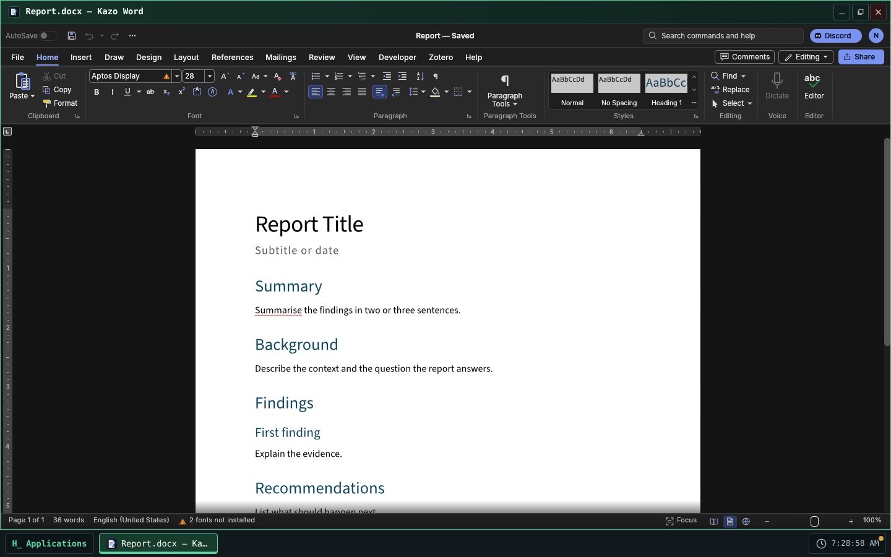
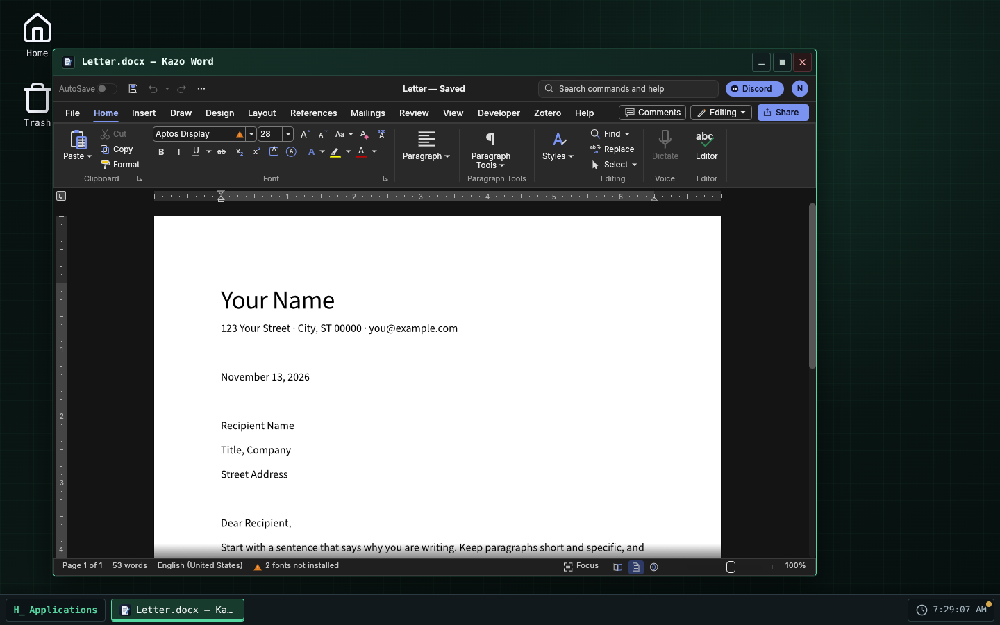
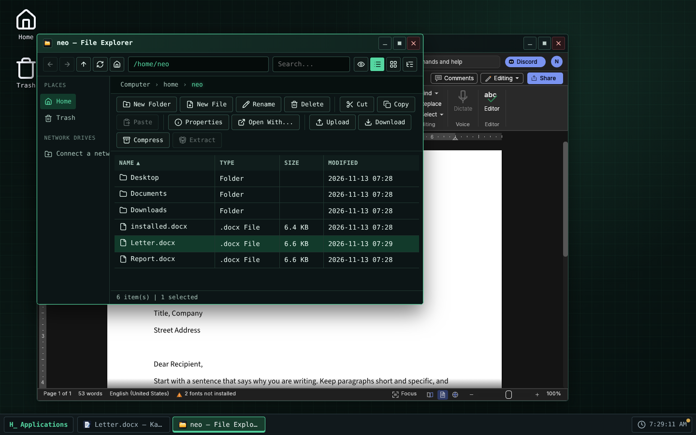

> [English version](README.md)

<!-- Fiche du Store : générée depuis store/ par .github/scripts/store-readme.mjs. Modifiez store/, puis lancez-le. -->


# Kazo Word

Un traitement de texte pour Kazo OS, pour les documents `.docx` et `.odt`. Kazo Word est basé sur
[WordCraft](https://github.com/storytold/wordcraft) de l'équipe ArtCraft, un traitement de texte
libre écrit en Rust, qui tourne ici dans une fenêtre de Kazo OS.

## Écrire

- Des pages mises en forme comme à l'impression : styles, polices, paragraphes, listes, tableaux,
  images, en-têtes et pieds de page, numéros de page, notes de bas de page, table des matières.
- Le ruban de WordCraft, sa recherche de commandes et ses raccourcis ; orthographe anglaise vérifiée
  pendant la frappe.
- Plusieurs fenêtres à la fois, un document par fenêtre.

## Vos fichiers Kazo OS

- Double-cliquez sur un fichier `.docx`, `.odt`, `.rtf`, `.doc`, `.md`, `.html` ou `.txt` dans
  l'Explorateur de fichiers, ou utilisez « Ouvrir avec » : le document s'ouvre dans Kazo Word.
- Enregistrer réécrit le fichier ouvert ; Enregistrer sous et le premier enregistrement d'un
  nouveau document passent par la boîte d'enregistrement de Kazo OS. Les exports PDF, PNG, texte
  et Markdown sont des copies : le document reste lié à son fichier.
- La barre de titre affiche `*` tant que le document a des changements non enregistrés, et fermer
  la fenêtre demande avant de les perdre.
- Fichier › Ouvrir, et les images, polices et listes de publipostage choisies dans WordCraft,
  viennent des fichiers de Kazo OS, par la boîte de dialogue de Kazo OS.
- Kazo Word suit le thème (clair ou sombre) et la langue de l'OS ; ses réglages sont gardés par
  utilisateur de Kazo OS dans `~/.config/ca.kazo.word/`.

## Limites connues

- **WordCraft est en alpha.** La plupart des documents s'ouvrent et s'enregistrent bien, mais
  gardez une copie des documents importants.
- **L'orthographe est vérifiée en anglais seulement** dans la version web de WordCraft.
- **Polices asiatiques** : seules de petites polices sont incluses ; le chinois, le japonais et le
  coréen peuvent mal s'afficher.
- WordCraft dessine avec **WebGPU ou WebGL 2** : un navigateur ou un ordinateur qui n'a ni l'un ni
  l'autre affiche un écran d'erreur au lieu du document.
- Le téléchargement est gros (environ 23 Mo, 61 Mo une fois installé) et chaque fenêtre charge sa
  propre copie de WordCraft (environ 130 Mo de mémoire pour la première fenêtre).
- L'impression passe par la boîte d'impression du navigateur.
- **L'enregistrement automatique (AutoSave) n'est pas encore disponible** : enregistrez avec
  Ctrl+S (Kazo-ca/Os-App-Word#17, en attente de WordCraft).
- Demande Kazo OS 3.3.2 ou plus récent.

## Licence

Kazo Word est un logiciel libre sous licence MIT. WordCraft est sous licence MIT ou Apache-2.0 ; ses
avis et les licences des polices et dictionnaires qu'il inclut sont livrés avec l'app (voir
`THIRD-PARTY-NOTICES-fr.md` dans le dépôt). Le nom et les logos ArtCraft sont des marques de
l'équipe ArtCraft et ne sont pas utilisés par Kazo Word.

## Captures d'écran

<p>
  
  
  
</p>

<!-- /Fiche du Store -->

## Essayer

<!-- Lien « Ouvrir dans Kazo OS » : https://os.kazo.ca/?autolaunch=ca.kazo.word va ici quand Kazo OS le prendra en charge. -->

Ouvrez [Kazo OS](https://os.kazo.ca/) et installez Kazo Word depuis le **Kazo OS Store** (catégorie Productivité), ou dans le Terminal de Kazo OS, en administrateur : `sudo kazopkg install Kazo-ca/Os-App-Word`.

## À propos de Kazo OS

[Kazo OS](https://github.com/Kazo-ca/Os) est un système d'exploitation simulé qui tourne dans le navigateur, écrit en C# avec Blazor WebAssembly. Il offre un environnement complet pour développer et exécuter des applications : bureau et fenêtres, système de fichiers persistant, processus, shell POSIX, réseau simulé, le Kazo OS Store, et un SDK public (paquets NuGet) pour créer des apps comme celle-ci. Essayez-le sur <https://os.kazo.ca/> (PWA, fonctionne hors ligne).

## Développement

- Plan : [plan](doc/fr/plan.md) et [plan d'intégration](doc/fr/integration-plan.md). Les avis de WordCraft et les licences du paquet : [THIRD-PARTY-NOTICES-fr.md](THIRD-PARTY-NOTICES-fr.md).

| Dossier | Contenu |
| --- | --- |
| `src/Kazo.Word` | L'app : `WordApp` (manifeste), `WordWindow` (la fenêtre), `Hosting/` (l'iframe), `wwwroot/host/` (la page de l'iframe et son proxy), `wwwroot/js/word-host.js` (côté OS), `wwwroot/wordcraft/` (le build de WordCraft) |
| `src/Kazo.Word.Os` | Un hôte qui lance tout Kazo OS avec les apps de base et Kazo Word : le projet à démarrer |
| `tests/Kazo.Word.Tests` | Tests C# : manifeste, démarrage de WordCraft, le build de WordCraft correspond à sa provenance |
| `tests/proxy` | Tests du proxy de l'iframe (avec un faux WordCraft) et du module côté OS, sous node |
| `tests/e2e` | Parcours dans l'hôte Kazo OS avec Playwright : démarrage, saisie, WebGPU et WebGL 2, deux fenêtres |
| `tests/installed` | L'app telle que le Store l'installe, dans un Kazo OS publié : `kazopkg install`, un `.docx` ouvert par double-clic, les captures du Store |
| `tools/vendor-wordcraft.sh` | Place un build de WordCraft dans `src/Kazo.Word/wwwroot/wordcraft/` avec sa provenance |
| `tools/build-wordcraft.sh` | Compile WordCraft depuis `external/wordcraft` et le place dans l'app |
| `external/KazoOs` | Le dépôt Kazo OS en sous-module git, sur un tag de release |
| `external/wordcraft` | Notre fork de WordCraft (`Kazo-ca/wordcraft`) en sous-module git : utile seulement pour compiler WordCraft |
| `store/` | Ce que montre le Kazo OS Store : icône (PNG 256×256), descriptions courtes, descriptions, captures d'écran, `store.json` |
| `THIRD-PARTY-NOTICES-fr.md` | WordCraft et ce qu'il embarque ; lié dans le paquet avec `LICENSE` (`wwwroot/legal/`) |

### Le build de WordCraft

`src/Kazo.Word/wwwroot/wordcraft/` n'est jamais modifié à la main (décision 13 du plan). Il est
compilé depuis le sous-module `external/wordcraft`, notre fork de WordCraft, et son
`wordcraft.json` nomme le commit du fork (un test C# vérifie que c'est celui du sous-module).

Pour changer de version de WordCraft : déplacez le sous-module sur un commit du fork (pour une
release, la branche `kazo/v<version>` du fork, faite depuis le tag amont) dans une PR. Le workflow
**Build WordCraft** le compile sur cette PR. Une fois fusionnée, lancez **Build WordCraft** depuis
l'onglet Actions sur cette branche : il compile, fait tourner la CI sur le résultat et ouvre une
PR qui remplace le dossier.

Le même build sur un ordinateur (Rust stable avec `wasm32-unknown-unknown`, Trunk 0.21.14, et
`storytold/craft-i18n` et `storytold/craft-fonts` aux révisions qu'épingle le sous-module ; le
script les vérifie) :

```bash
git submodule update --init external/wordcraft
CRAFT_I18N_DIR=<craft-i18n> CRAFT_FONTS_DIR=<craft-fonts> tools/build-wordcraft.sh
```

`tools/vendor-wordcraft.sh` prend aussi le zip officiel de WordCraft (la source jusqu'au chantier 4) :

```bash
tools/vendor-wordcraft.sh                 # télécharge le zip officiel épinglé et le vérifie
tools/vendor-wordcraft.sh --zip <fichier> # pareil, depuis un zip déjà téléchargé
tools/vendor-wordcraft.sh --dir <dossier> # un dossier compilé depuis external/wordcraft par packaging/web/package.sh
```

Le `.wasm` fait 61 Mo : GitHub avertit au push, et l'accepte.

### Tests

```bash
dotnet build Kazo.Word.slnx -c Release
dotnet test Kazo.Word.slnx -c Release --no-build
npm ci
npm test               # le proxy et le module côté OS
npm run test:e2e       # Playwright, dans l'hôte Release (Chromium) : démarrage, ouvrir et enregistrer
```

L'app telle que le Store l'installe, dans un Kazo OS publié (pas en CI : environ cinq minutes) :

```bash
dotnet build src/Kazo.Word -c Release -t:KazoOsPack
# kazoos-wasm-<version>.zip d'une release de Kazo OS (3.3.2 ou plus récente), dézippé dans <os>
npm run test:installed -- <os> [dossier des paquets] [dossier des captures]
npm run test:installed -- --store <os>   # après une release : installe depuis le vrai Kazo OS Store
```

Il installe Kazo Word par `sudo kazopkg install Kazo-ca/Os-App-Word` (GitHub servi depuis les
paquets locaux), enregistre un `.docx`, le double-clique dans l'Explorateur de fichiers et vérifie
que Kazo Word l'ouvre. Avec un dossier de captures, il écrit aussi les captures du Store
(`store/screenshots/`).

Lancez `launch ca.kazo.word --webgl` dans le terminal de Kazo OS pour forcer le rendu WebGL 2
de WordCraft.

### Premiers pas

```bash
# Un dépôt créé depuis le template GitHub a déjà le sous-module :
git clone --recurse-submodules <votre dépôt>

# Un dossier créé par « dotnet new kazoos-solution » l'ajoute une fois :
git init
git submodule add --depth 1 https://github.com/Kazo-ca/Os.git external/KazoOs
git -C external/KazoOs checkout v<version de Kazo OS>
```

Ouvrez ensuite `Kazo.Word.slnx` dans Visual Studio ou Rider et démarrez `Kazo.Word.Os`,
ou lancez `dotnet run --project src/Kazo.Word.Os`.

### La version de Kazo OS

`external/KazoOs/wasm2/KazoOs/build/Versions.props` est la version de Kazo OS de ce dépôt.
Pour changer de version, placez le sous-module sur son tag et validez-le :

```bash
git -C external/KazoOs fetch --depth 1 origin tag v2.2.0
git -C external/KazoOs checkout v2.2.0
git add external/KazoOs
```

Ne modifiez jamais le sous-module : on ne modifie pas l'OS depuis un dépôt d'app, et la CI refuse
un sous-module modifié ou hors de son tag.

### Deux profils de build

| Profil | Kazo OS vient de | Usage |
| --- | --- | --- |
| `Debug` | les projets du sous-module (`KazoOsUseSource=true`) | entrer dans le SDK et l'OS, points d'arrêt partout |
| `Release` | les paquets `Kazo.Os.*` de nuget.org, à la version du sous-module | CI, `dotnet publish`, le Kazo OS Store |

Forcez l'un ou l'autre avec `-p:KazoOsUseSource=true` ou `false`.

### Publier dans le Kazo OS Store

1. Remplissez `store/` (icône, descriptions courtes, descriptions, captures d'écran, catégorie et
   étiquettes dans `store.json`), puis lancez `npm run store:readme` : il copie les descriptions et
   les captures en haut de `README.md` et de `readme-fr.md`. La CI échoue quand un README diffère de
   `store/`.
2. Changez `Version` dans la classe `[AppManifest]` de l'app et validez-la dans `main`, puis posez le
   tag : lancez le workflow **Tag a release** (onglet Actions, ou l'API GitHub pour un agent), qui pose
   sur la tête de `main` le tag de la version du manifeste et lance les deux workflows de
   publication ; ou poussez le tag vous-même : `git tag v1.0.0 && git push --tags`.
3. Le workflow **Publish to the Kazo OS Store** compile l'app et produit le dossier du catalogue
   `apps/<appId>_<version>/`. Avec un secret `HACK_STORE_TOKEN` (un jeton qui peut créer un fork et
   ouvrir des pull requests), il ouvre la pull request vers `Kazo-ca/Os-AppMarketPlace` depuis
   votre fork ; sans lui, téléchargez l'artefact du workflow et ouvrez la pull request vous-même.

`HACK_STORE_TOKEN` est un jeton d'accès personnel GitHub à vous, que Kazo OS ne fournit pas :

1. GitHub ▸ **Settings** ▸ **Developer settings** ▸ **Personal access tokens** ▸ **Tokens (classic)** ▸
   **Generate new token (classic)**, avec une expiration courte et les scopes **`repo`** et
   **`workflow`** (un jeton à grain fin ne peut pas couvrir à la fois votre fork et le dépôt du catalogue).
2. Copiez-le (affiché une seule fois) dans ce dépôt : **Settings** ▸ **Secrets and variables** ▸
   **Actions** ▸ **New repository secret**, nom `HACK_STORE_TOKEN` (ou `gh secret set HACK_STORE_TOKEN`).

`repo` donne accès à tous vos dépôts : gardez le jeton dans ce seul secret et révoquez-le au moindre doute.

Le catalogue ne prend jamais de binaire de votre part : une fois votre pull request relue et
fusionnée, sa CI compile l'app au commit du tag.

### Publier sur la branche `kazoos-packages`

Le même tag `v*` lance aussi **Publish the Kazo OS packages** : il fait le paquet de l'app et le
pousse sur la branche `kazoos-packages` de ce dépôt, en gardant les versions déjà publiées. Les
utilisateurs de Kazo OS l'installent alors avec `kazopkg install <owner>/<repo>`, sans le Kazo OS Store.

Ces paquets ne sont pas signés : les apps sont signées seulement dans le dépôt du Kazo OS Store
(`Kazo-ca/Os-AppMarketPlace`), quand il compile votre app depuis le catalogue (ADR 0219). Kazo OS
les vérifie par leur SHA-256 et demande un administrateur avant d'installer depuis une source non
fiable. Pour un paquet signé, installez l'app depuis le Kazo OS Store.

### Plan

Le plan de l'app Kazo Word (WordCraft dans Kazo OS) est dans [`doc/fr/plan.md`](doc/fr/plan.md) ; l'index de la documentation est [`doc/fr/README.md`](doc/fr/README.md).
